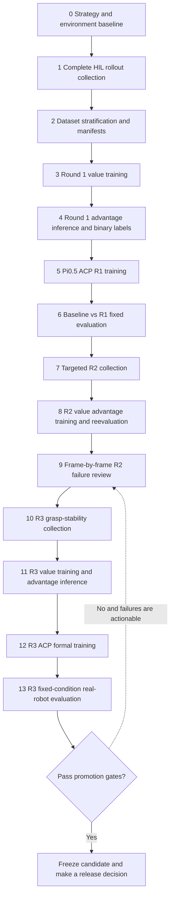
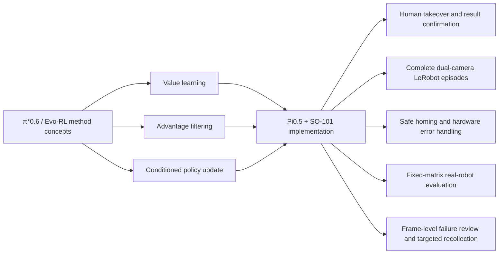

# Project Flow and Method Provenance

## Implemented project path

Solid arrows represent completed or explicitly scheduled project stages. The dashed arrow is a future conditional round, not an executed loop.

The implemented evidence currently ends at R3 formal training preparation. A complete next-round data loop requires R3 evaluation, another targeted collection, and another value/ACP training round.

## Relationship to π*0.6 and Evo-RL

This repository borrows the value-learning, advantage-filtering, and conditional-update mechanisms. It does not claim to reproduce the complete π*0.6 algorithm, automatic continuous rollout, or the paper's reported results.

## Decision rule

- Better than the frozen baseline and safe: eligible for promotion.
- Weaker than the baseline but failures are reliable and actionable: eligible for another targeted improvement round, not promotion.
- Calibration, homing, communication, labeling, or data integrity is unreliable: stop and repair the system before collecting more training data.
